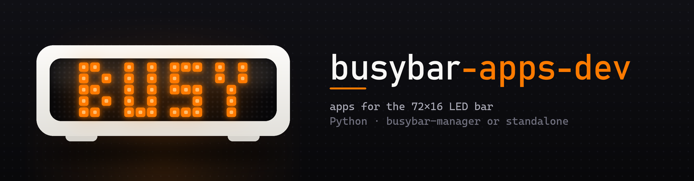
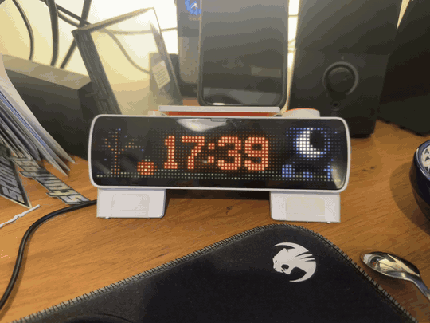
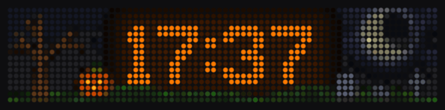

# busybar-apps-dev

Apps for the [BUSY Bar](https://busy.app) (72×16 RGB LED display), written in Python with the standard
library only. They work with [busybar-manager](https://github.com/maxswinkels/busybar-manager) or
on their own.

## Steal These Buttons

One whole classic 80×15 web button at a time (`apps/stb-clock`), from the
[Steal These Buttons](https://taylor.fyi/buttons/) collection, swapped every 10 seconds with a hard
cut. The time is drawn transparently on the artwork: black or white 3×5 digits, chosen per button, in
the corner where they read best and cover the least.

- **No button image lives in this repository.** `assets/buttons.txt` lists the 85 wanted file names;
  the first start downloads the missing ones into `cache/buttons/` (git-ignored), which then works
  offline. Delete the folder to fetch everything again.
- The 80 px button does not fit the 72 px screen, and scaling smears its 1 px glyph strokes, so the 8
  columns with the least horizontal contrast (background, padding, gaps between letters) are deleted:
  every displayed pixel is an original pixel. 85 buttons, shuffled at every start.
- **Turn the wheel** to step through them, click it to go one forward; the auto swap waits a full
  `--hold` after a manual pick.
- The clock picks its corner and alignment per button (readable first, then the emptiest spot, flush
  against the border). A 1 px halo - or, on the one busy photo button, a small plate - appears only
  when the artwork leaves no other way; `--clock-style outline` gives hollow digits with a black halo.
- Two elements, one draw per swap and one per minute: the bar costs 40-110 ms per draw, and frequent
  draws made it glitch.

    python apps/stb-clock/app.py --host 10.0.4.20      # or enable it in the manager
    python apps/stb-clock/app.py --hold 30 --clock top-left --wheel off

`apps/stb-clock/README.md` has the full option list, how the pixel fitting and clock placement work,
and how to add your own button names. The buttons belong to their authors: the repo carries only the
list, and the app caches what it downloads.

## Halloween Clock

*The real bar. Below: a stormy night, rendered from the bar's screen, with a bat crossing in front of the time and lightning charging the clock.*

An orange clock over an animated night graveyard (`apps/halloween-clock`):

- **Random weather**: calm (stars), stormy (heavy clouds, thunder) or foggy (haze, ground mist, thunder).
- **Random moon**: full, half, crescent or blood moon, with a faint outline so the shape stays readable
  behind clouds.
- **Bats** fly across the bar, in front of the time.
- **Lightning charges the clock**: the digits and the glow behind them flicker with the bolts, go electric
  green, then slowly sweep back to orange. There is also a strike at every new hour in stormy and
  foggy weather.
- The weather and moon are re-rolled every hour. All the animations are `.anim` files played by the
  bar's firmware, so the app only talks to the bar once a minute and when an event fires.

### Run it with busybar-manager

1. Install and start the manager (Node 22+, Python 3):

       git clone https://github.com/maxswinkels/busybar-manager.git
       cd busybar-manager
       npm run build
       node server.js          # Windows: BUSYBAR_PYTHON=python node server.js

   Open http://127.0.0.1:8321 and set your bar's address in the settings.
2. Clone this repo and tell the manager where the apps are, in the manager's `config.json`
   (forward slashes, even on Windows), then restart the manager:

       "appsDirs": ["C:/path/to/busybar-apps-dev/apps"]

   Or zip the `apps/halloween-clock` folder (the zip must contain exactly that one folder with
   `app.py` inside) and use **Library, upload a zipped app**.
3. In the dashboard, enable **Halloween Clock**. Its options (weather, moon, colour, 12h clock, how often
   bats and thunder appear, ...) show up as controls. The scene is blank for about 20 seconds at start
   while it uploads its animations (about 1 MB).

### Run it without the manager

    python apps/halloween-clock/app.py --host 10.0.4.20

`10.0.4.20` is the bar over USB (the default). For the [busybar-emulator](https://github.com/maxswinkels/busybar-emulator)
use `--host 127.0.0.1:8080`. The app does not send an access token, so if your bar requires one, run
the app through the manager, which forwards the draws to the bar for you.

    python apps/halloween-clock/app.py --weather stormy --moon blood     # fixed scene
    python apps/halloween-clock/app.py --hour12 --color "#00FFAA"        # 12h clock, other colour
    python apps/halloween-clock/app.py --bat-min 10 --bat-max 30         # more bats
    python apps/halloween-clock/app.py --thunder-max 0                   # no thunder
    python apps/halloween-clock/app.py --night                           # for the lowest bar brightness
    python apps/halloween-clock/app.py --help                            # everything

### Rebuild the animations

The `.anim` files in `apps/halloween-clock/assets` are generated (needs Pillow for the previews, `pip install pillow`):

    python tools/gen_graveyard.py     # sky, moon, scenery, bats, thunder (takes ~2 minutes)

    python tools/gen_night.py         # the hand-drawn pixel-art set used by --night (a few seconds)

Restart the app afterwards, since it uploads the files at startup.

### Night mode (`--night`)

At the lowest bar brightness the firmware renders dim or mixed colours as pale white-blue dots,
and the faint orange glow behind the time as green dots. `--night` plays `night_*.anim` instead:
hand-drawn pixel art (tree swaying in the wind, a big jack-o'-lantern, tombstones, moon, opaque
clouds), fully opaque, a handful of saturated colours, no glow and no mist. The bar reports its
brightness as `auto`, so the app cannot detect low light: switch the flag on yourself.

## Other apps

- `apps/jam-intro`: Stunfest / Octojam jam-stand show: a pool scene with the title and the Stunfest logo,
  plus plasma, starfield, fire and sparkle effects. Runs on its own (`apps/jam-intro/run-jam-intro.command`),
  see its README. `tools/jam-loop` pre-renders the title and logo loops into the `.anim` files it plays.
  The Stunfest and Octojam logos belong to the association 3 Hit Combo (personal / jam use, not commercial).
- `apps/hello-bar`: minimal starter app.

Each app is a folder under `apps/` with `app.py` (argparse options become dashboard controls) and
`manifest.yaml`. Start from `apps/hello-bar`.

## Notes for hackers

`CLAUDE.md` lists what I learned about the bar's behaviour while building this: redraw and z-order
quirks, upload timeouts, how the charge animations are generated, and how to verify changes by
capturing the real screen.

The logo is drawn the same way, not hand-drawn: `python tools/gen_logo.py` regenerates
`docs/logo.png` (the square avatar) and `docs/banner.png` (the banner above) from the bar's real
proportions, its LED pitch and its "BUSY" wordmark set in the 3×5 pixel font.
