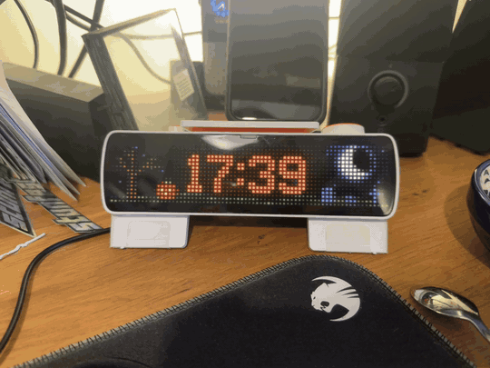
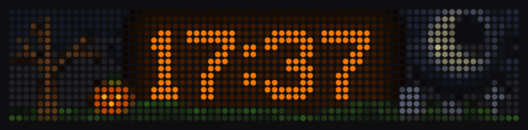

# busybar-apps-dev

Apps for the [BUSY Bar](https://busy.app) (72×16 RGB LED display), written in Python with the standard
library only. They work with [busybar-manager](https://github.com/maxswinkels/busybar-manager) or
on their own.

## Halloween Clock

*The real bar. Below: a stormy night, rendered from the bar's screen, with a bat crossing in front of the time and lightning charging the clock.*

An orange clock over an animated night graveyard (`apps/halloween-clock`):

- **Random weather**: calm (stars), stormy (heavy clouds, thunder) or foggy (haze, ground mist, thunder).
- **Random moon**: full, half, crescent or blood moon, with a faint outline so the shape stays readable
  behind clouds.
- **Bats** fly across the bar, in front of the time.
- **Lightning charges the clock**: the digits and the glow behind them flicker with the bolts, go electric
  green, then slowly sweep back to orange. There is also a strike at every new hour in stormy and
  foggy weather.
- The weather and moon are re-rolled every hour. All the animations are `.anim` files played by the
  bar's firmware, so the app only talks to the bar once a minute and when an event fires.

### Run it with busybar-manager

1. Install and start the manager (Node 22+, Python 3):

       git clone https://github.com/maxswinkels/busybar-manager.git
       cd busybar-manager
       npm run build
       node server.js          # Windows: BUSYBAR_PYTHON=python node server.js

   Open http://127.0.0.1:8321 and set your bar's address in the settings.
2. Clone this repo and tell the manager where the apps are, in the manager's `config.json`
   (forward slashes, even on Windows), then restart the manager:

       "appsDirs": ["C:/path/to/busybar-apps-dev/apps"]

   Or zip the `apps/halloween-clock` folder (the zip must contain exactly that one folder with
   `app.py` inside) and use **Library, upload a zipped app**.
3. In the dashboard, enable **Halloween Clock**. Its options (weather, moon, colour, 12h clock, how often
   bats and thunder appear, ...) show up as controls. The scene is blank for about 20 seconds at start
   while it uploads its animations (about 1 MB).

### Run it without the manager

    python apps/halloween-clock/app.py --host 10.0.4.20

`10.0.4.20` is the bar over USB (the default). For the [busybar-emulator](https://github.com/maxswinkels/busybar-emulator)
use `--host 127.0.0.1:8080`. The app does not send an access token, so if your bar requires one, run
the app through the manager, which forwards the draws to the bar for you.

    python apps/halloween-clock/app.py --weather stormy --moon blood     # fixed scene
    python apps/halloween-clock/app.py --hour12 --color "#00FFAA"        # 12h clock, other colour
    python apps/halloween-clock/app.py --bat-min 10 --bat-max 30         # more bats
    python apps/halloween-clock/app.py --thunder-max 0                   # no thunder
    python apps/halloween-clock/app.py --night                           # for the lowest bar brightness
    python apps/halloween-clock/app.py --help                            # everything

### Rebuild the animations

The `.anim` files in `apps/halloween-clock/assets` are generated (needs Pillow for the previews, `pip install pillow`):

    python tools/gen_graveyard.py     # sky, moon, scenery, bats, thunder (takes ~2 minutes)

    python tools/gen_night.py         # the hand-drawn pixel-art set used by --night (a few seconds)

Restart the app afterwards, since it uploads the files at startup.

### Night mode (`--night`)

At the lowest bar brightness the firmware renders dim or mixed colours as pale white-blue dots,
and the faint orange glow behind the time as green dots. `--night` plays `night_*.anim` instead:
hand-drawn pixel art (tree swaying in the wind, a big jack-o'-lantern, tombstones, moon, opaque
clouds), fully opaque, a handful of saturated colours, no glow and no mist. The bar reports its
brightness as `auto`, so the app cannot detect low light: switch the flag on yourself.

## Other apps

- `apps/jam-intro`: Stunfest / Octojam jam-stand show: a pool scene with the title and the Stunfest logo,
  plus plasma, starfield, fire and sparkle effects. Runs on its own (`apps/jam-intro/run-jam-intro.command`),
  see its README. `tools/jam-loop` pre-renders the title and logo loops into the `.anim` files it plays.
  The Stunfest and Octojam logos belong to the association 3 Hit Combo (personal / jam use, not commercial).
- `apps/hello-bar`: minimal starter app.

Each app is a folder under `apps/` with `app.py` (argparse options become dashboard controls) and
`manifest.yaml`. Start from `apps/hello-bar`.

## Notes for hackers

`CLAUDE.md` lists what I learned about the bar's behaviour while building this: redraw and z-order
quirks, upload timeouts, how the charge animations are generated, and how to verify changes by
capturing the real screen.
